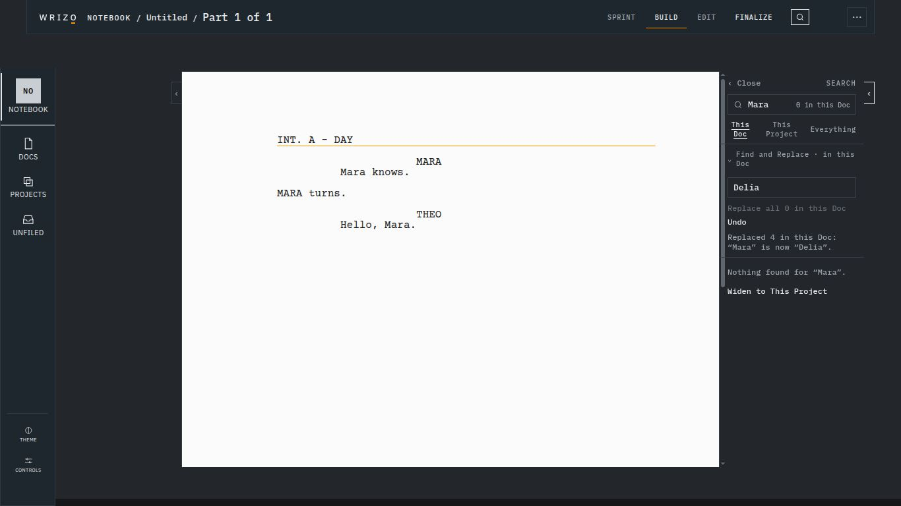
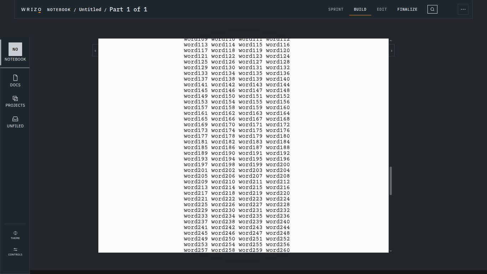
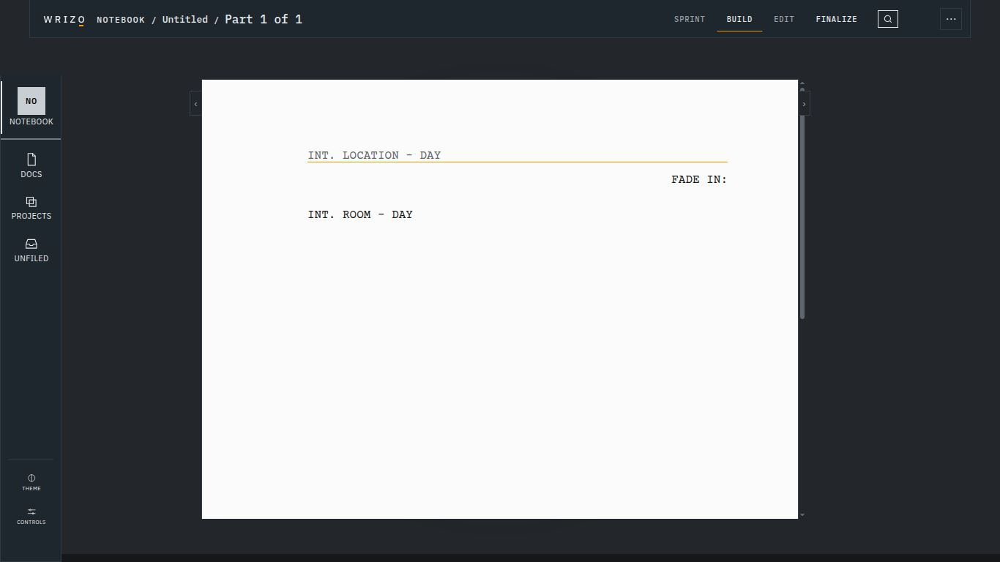
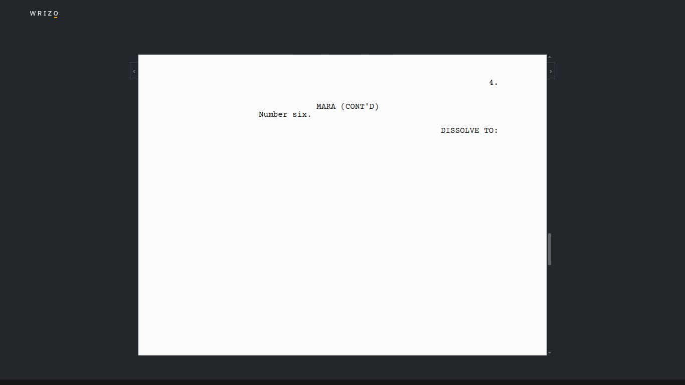
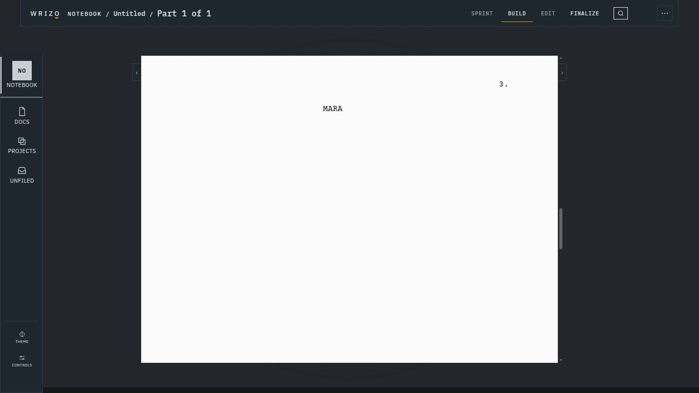
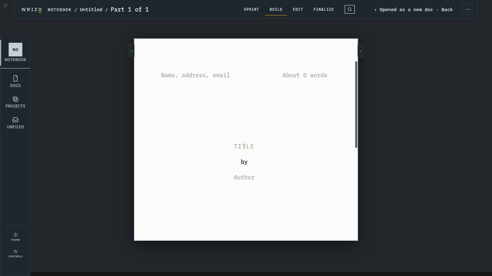
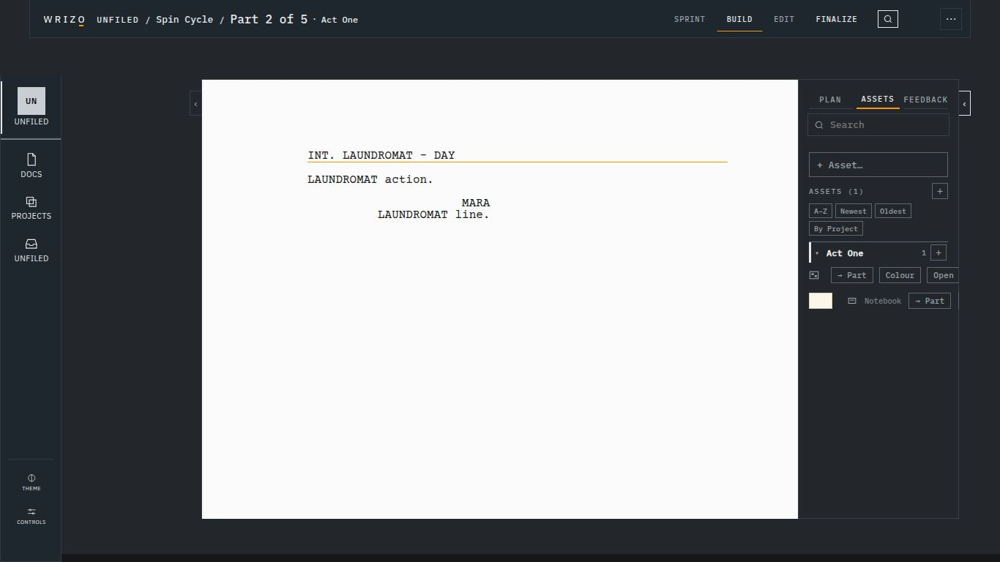

# Wrizo screenwriting review

**SCRIPT lane · November 22, 2026 · for Nick and Fable** · brief: `claude/screenwriting-review-brief.md`

> **Read this first**
> - **The panel is simulated.** The four reviewers are professional viewpoints played by Claude, not working screenwriters. Every bug below was measured in a real browser. The craft judgments are informed, but a real screenwriter should sanity-check the priorities before you spend heavily on them.
> - **What was tested:** build `91d8f2fac`, the train K candidate with the reorg on by default. Production is train I, where the reorg still needs `?reorg=1`. The screenplay editor is the same in both apart from one chrome-fade line, so the editor findings apply to production today.
> - **No account was used.** The harness runs the app with its built-in test sign-in on GitHub Actions. Sync, sharing and the live site were not exercised, and neither were "main" or "sample".
> - **Final Draft and Fade In were read, not run.** Their column comes from their own current documentation. Where a vendor doesn't state something, the table says so.

---

## 1. The verdict

**Can a working screenwriter use Wrizo today? For a private first draft of a short, yes. For anything another person has to read, no.**

The page itself is right. Margins, Courier 12 pt, the eight elements, the Enter flow and name completion all feel like a real screenwriting tool within a minute. What sits behind that page isn't ready: **a script cannot leave Wrizo in a form the industry accepts**, page breaks don't follow the conventions, and most of the reorg treats a screenplay as an afterthought.

| Format | Today | What stops it |
|---|---|---|
| **Short** (indie, 5–15 pages) | **Usable for a private first draft** | No PDF, so it can't go to a producer, actor or festival. No dual dialogue. Tab can rewrite a line by accident, and undo won't reliably save you. |
| **Feature** (90–120 pages) | **No** | Acts are separate documents: page numbers restart, names don't carry across, and the whole-script download comes out in the wrong order. No scene list, no way to move a scene. Replace All doesn't work. Page counts can't be trusted. |
| **TV episode** | **No** | All of the feature's problems, plus no revisions, coloured pages, locked pages or scene numbers. A writers' room can't run a single production day on it. |

**Four things to fix first:**

1. **Replace All says it worked and changes nothing** in a screenplay (finding 1).
2. **A speech longer than a page disappears behind the next page** (finding 2).
3. **Editing can damage a line with no way back:** Tab rewrites written lines, Backspace on a selection glues lines together, and undo stops at the line (findings 3–5).
4. **There is no PDF.** Nothing else on this list matters as much to a professional.

The sixteen fixes in batches 1–3 (section 4) need no new saved data and would make Wrizo a credible **spec-drafting** tool. Production features such as revisions and locked pages are a much larger, separate decision.

---

## 2. Parity with Final Draft and Fade In

**Has** = works as a pro expects · **Half** = partly there or has a defect · **No** = not built.
Versions checked November 22, 2026: **Final Draft 13** ([$199.99 on promotion, $249.99 list][fd-price]) and **Fade In 5.0.15** ([$79.95][fi-buy], [released Sept 25, 2026][fi-ver]). "§" refers to the [Final Draft 13 User Guide][fd]. "Not stated" means the vendor's readable docs don't say; it doesn't mean the feature is absent.

| Feature | Wrizo | Final Draft 13 | Fade In 5.0.15 |
|---|---|---|---|
| **Formatting** | | | |
| The eight elements | **Has** | Yes, §1.16.1 | Automatic element flow, [features][fi-f]; list not enumerated |
| Enter cycling | **Has** (one cell differs, finding 31) | Yes, §1.26.1 | Customisable, [KB][fi-keys] |
| Tab cycling | **Half**: rewrites written lines | Yes, §1.26.2 | Separate before/after-text Tab settings, [KB][fi-keys] |
| Industry margins, Courier 12 pt | **Has** (measured 1.5 / 2.5 / 3.1 / 3.7 in) | Courier Final Draft default, §1.28 | Screenplay Courier recommended, [support][fi-s] |
| About a page a minute | **Half**: page count runs long | Goal stated, §1.15.4 | Scene timing, [comparison][fi-c] |
| **Speed aids** | | | |
| Names, locations, times | **Half**: stops at each act | SmartType, §1.25 | Yes, customisable lists, [features][fi-f] |
| Character extensions | **Has** | Yes, §1.25.8 | Not stated |
| Automatic (CONT'D) | **Half**: wrong across scenes | Yes, §1.10.1.4 | Yes, with override, [KB][fi-contd] |
| Automatic parentheses | **No** | Yes, §1.16.1 | Not stated |
| Dual dialogue | **No** | Yes, §1.8.1.2 | Yes, [KB][fi-dual] |
| **Pagination** | | | |
| Dialogue splits with (MORE)/(CONT'D) | **No** | Yes, §1.10.1.4 | "More and Continued" yes, [comparison][fi-c] |
| Break action at sentences | **No** | Yes, §1.10.1.3.3 | Not stated |
| Scene heading never last on a page | **Has** | Yes, §1.16.1 | Not stated |
| Character cue stays with its speech | **Half**: can strand a cue | Designed to prevent it, §1.15.4 | Not stated |
| **Structure** | | | |
| Navigator / scene list | **No** | Yes, §1.18 | Yes, [features][fi-f] |
| Index cards / beat board | **Half**: Boards exist, not tied to scenes | Beat Board, §1.17.1 | Index cards, [features][fi-f] |
| Outline | **Half**: Plan exists, its door makes prose | Outline Editor, §1.17.2 | Yes, [features][fi-f] |
| Acts, sequences, episodes | **Half**: presets and nesting; acts don't join up | New Act elements §1.26.1; TV templates §1.5.1.2 | Nested sequences, [features][fi-f]; TV templates, [comparison][fi-c] |
| Reorder scenes | **No** (whole Parts only) | Drag in the Navigator, §1.18.2.3 | Yes, [features][fi-f] |
| **Revisions and production** | | | |
| Revision mode, marks, colours | **No** | Yes, §1.12.4–1.12.8 | Yes, [features][fi-f] |
| Locked pages, A-pages | **No** | Yes, §1.12.9–1.12.13 | Page locking, [features][fi-f] |
| Scene numbers, omitted scenes | **No** (field reserved, unused) | Yes, §1.12.1–1.12.3 | Yes, [features][fi-f], [comparison][fi-c] |
| Title page | **Half**: a separate prose page | Yes, §1.4.6 | Yes, [features][fi-f] |
| Reports | **No** | Scene, location, character, cast and more, §1.11.3.3 | Scenes, cast, locations and more, [features][fi-f] |
| **Interchange** | | | |
| PDF export | **No** | Yes, §1.5.2.5 | Yes, [features][fi-f] |
| Final Draft (.fdx) | **No** | Native, §1.5.1.4 | Import and export, [support][fi-s] |
| Fountain | **No** | Not in the FD13 guide | Yes, [comparison][fi-c] |
| Import an existing script | **No** | PDF, RTF, text, §1.5.1.4 | FDX, RTF, PDF and more, [features][fi-f], [KB][fi-kb] |
| **Collaboration and notes** | | | |
| Script notes | **No** | ScriptNotes, §1.18.3 | Sticky notes, [features][fi-f] |
| Tracked changes / compare | **No** | Yes, §1.6.5 and §1.11.3.7 | Compare to Previous, [KB][fi-track] |
| Real-time collaboration | **No** | Yes, §1.11.3.1 | Yes, [KB][fi-rt] |
| **Reading and statistics** | | | |
| Page count | **Half**: page numbers, no total | Page and length per scene, §1.11.3.3 | Not stated |
| Scene length, dialogue balance | **No** | Scene and Statistics reports, §1.11.3.3 | Scene timing, [comparison][fi-c]; Dialogue Tuner, [features][fi-f] |
| Read aloud | **No** | Speech Control by character, §1.11.2 | Table Read, [KB][fi-tts] |

---

## 3. Findings, worst first

Test IDs (K1, P2…) are the checks in the harness. Code references are at `91d8f2fac`, under `apps/desktop/src/`.

### A. Text lost, hidden or misformatted

**1. Replace All reports success and changes nothing.** (F2, F3)
- **Did:** Replaced "Mara" with "Delia" across a scene.
- **Happened:** The panel said *Replaced 4 in this Doc: "Mara" is now "Delia"*. All four MARAs stayed on the page and in the saved script. Only the hidden derived text changed, so a second search finds nothing. The next edit overwrote it and the old name came back.
- **A pro expects:** A character rename is one of the most common production-week edits. A false "done" here sends a script out with the wrong name.
- **Where:** `reorg/search/replace.ts:34-43` writes `entry.text` and never touches `entry.script`.

**2. A speech longer than a page is hidden behind the next page.** (P2, P2b)
- **Did:** Wrote a 420-word monologue.
- **Happened:** The speech ran 46 lines past the bottom margin. The next sheet painted over it, so word 300 and the final word can't be seen or clicked. The words are still saved. It starts at roughly 300 words of unbroken speech.
- **A pro expects:** The speech breaks across pages with (MORE) and (CONT'D), FD §1.10.1.4.
- **Where:** `store/scriptPaginate.ts:32` (dialogue can't split); `styles/09-board-card.css:215` (fixed-height sheet, visible overflow).

**3. Selecting text and pressing Backspace or Enter does the wrong thing.** (K6, K7)
- **Did:** Selected a whole line and pressed Backspace. Separately, selected words and pressed Enter.
- **Happened:** Backspace deleted nothing and glued the line onto the one above (`First line.Second line.`). Enter kept the selected words instead of replacing them.
- **A pro expects:** What every word processor does.
- **Where:** `components/ScriptEditor.tsx:350` and `:313`. `script/caret.ts:41` reads only the selection's start.

**4. Undo stops at the edge of a line.** (K10, K11, K12; control K17 passes)
- **Did:** Split a line with Enter, joined two with Backspace, and typed then clicked to another line. Pressed Ctrl+Z after each.
- **Happened:** None of the three was undone. Undo works only while the caret stays in the same line.
- **A pro expects:** Deep undo across the whole script. This is what makes findings 3 and 5 dangerous.
- **Where:** `ScriptEditor.tsx` has no history. Each line is its own short-lived editor.

**5. Tab rewrites a line you've already written.** (K1, K2, K3)
- **Did:** Pressed Tab at the end of a written line.
- **Happened:** An action line became a character cue. A cue became a transition. A speech became a parenthetical.
- **A pro expects:** Tab adds the next element. FD allows Character to Transition "only when character is blank" (§1.26.2), and by default Tab after a name opens a parenthetical (§1.25.8). Final Draft users press Tab constantly, so they'll hit this within minutes.
- **Where:** `ScriptEditor.tsx:335-339`.

**6. The whole-script download ignores your act order.** (R8)
- **Did:** Moved Act Three to the front and downloaded the script.
- **Happened:** The file came out in the original creation order. Act names are missing, and each act's first slugline appears twice, once as a Markdown title.
- **A pro expects:** The script in the order on screen.
- **Where:** `store/pageExport.ts:234` sorts by creation date. Prose Docs that use this same download path are probably affected too (read from the code, not tested).

**7. New Part and the Plan's door put a prose page inside a screenplay.** (R9, R10; measured in Machina)
- **Did:** Pressed New Part in a Screenplay Doc, then followed the Plan's route to a new Part.
- **Happened:** Both opened a prose page.
- **A pro expects:** A new act in a screenplay is a screenplay.
- **Where:** `reorg/PartsList.tsx:227`, `reorg/backMenu/planPart.ts:38`.

**8. A script that opens with FADE IN: gains a blank scene heading.** (K14)
- **Did:** Typed FADE IN: as the first line, saved, reopened.
- **Happened:** An empty scene heading now sits above it, on the first page of nearly every script.
- **Where:** `store/scriptDoc.ts:46-49`.

**9. Parentheticals get no parentheses.** (K4) Typing `beat` stores and exports `beat`. FD adds them automatically (§1.16.1).

**10. An action line starting "Est." turns into a scene heading.** (K15) `Est. 1962, says the sign.` is promoted as you type, and the code re-promotes it on the next keystroke if you change it back. `store/scriptSmartText.ts:9`, `ScriptEditor.tsx:276`.

**11. Enter in the middle of a speech turns the second half into Action.** (K5) `ScriptEditor.tsx:322`.

### B. Conventions broken

**12. No (MORE) or (CONT'D) at page breaks.** (P1, W2) A speech that doesn't fit moves whole to the next page. In the panel's short, page 2 stops at 37 of 54 lines. Readers and production staff read this as a formatting error.

**13. The page-break repair creates extra pages and can strand a cue.** (P3, P4, W3)
- **Did:** Typed a real short of 950 words.
- **Happened:** Its 196 lines fit four pages, but Wrizo shows **five, with a page 4 holding only four lines**. In a constructed case, a character name sat alone on a page with the speech on the next. Running the real paginator with and without its repair pass gives 4 and 5 pages.
- **A pro expects:** Page count is the currency of the business (FD §1.15.4). A wrong count misstates running time.
- **Where:** `store/scriptPaginate.ts:186-189` opens a new page instead of flowing into the next one.

**14. Automatic (CONT'D) gets three rules wrong.** (C2, C3, C4) It's added across a scene break, which FD says it must not be (§1.10.1.4). It comes back when a writer deletes it, and Fade In documents a [one-occurrence override][fi-contd]. It ignores an interrupting General element. `store/scriptSmartText.ts:18-34`.

**15. Action paragraphs never break across pages.** (P5) This leaves holes at page bottoms and inflates the count. FD breaks at sentences (§1.10.1.3.3).

### C. Missing must-haves

**16. No PDF, Final Draft or Fountain export.** (X1, X2) The options are `.md`, `.txt` and copy. Both drop the layout: cues and dialogue are no longer indented, and rendered Markdown runs a cue and its speech into one paragraph.

**17. Acts don't add up to one script.** (R1–R6) Each act restarts at page 1. Act Two doesn't know Act One's characters. The Parts list shows 0 words for written acts and calls unnamed ones "Untitled". Split and Merge refuse screenplays. `reorg/parts.ts:155`, `:461`, `:504`.

**18. No scene list, and no way to move a scene.** (K13) Ctrl+A selects one line and selection can't cross lines, so a scene can't even be cut and pasted. Moving scenes is the heart of a rewrite.

**19. No dual dialogue.** The data field is reserved and unused (`types/script.ts:8`).

**20. No revision mode, coloured pages, locked pages, scene numbers or omitted scenes.** The Edit stage is switched off on screenplays (V3).

**21. The title page isn't a screenplay title page.** (V4) It opens as a separate new page outside the script, laid out for a manuscript: contact details top left, "About 0 words", "by". The Doc menu's Special Parts are hidden for screenplays (`reorg/DocKindMenu.tsx:53`).

**22. No reports** (scene, character, location, cast, dialogue balance).

**23. No script notes, comments or tracked changes.**

**24. No way to bring an existing script in.** No import exists for screenplay formats, and the screenplay page blocks pasting foreign text (read from `script/elements.tsx:75-90`, not driven). Convert to Screenplay was [retired on purpose (item 184)](https://github.com/303webhouse/wrizo/commit/11b93b018), so choosing Screenplay on a written page opens a new blank script and leaves the original untouched. Together these mean a writer with a script in progress can't move to Wrizo.

### D. Friction

**25. No card or Board beside a screenplay.** (R11) "Open beside" isn't offered on a script page. The same control works on a prose page. `components/Tutor.tsx:848`, `ConnectionsDrawerPanel.tsx:217`.

**26. No Typewriter or Free Write on a screenplay.** (V2) The Sprint tab is switched off, so Wrizo's signature drafting mode is missing for screenwriters. `ScriptEditor.tsx:677`.

**27. Finalize opens the older Publish dialog** rather than the reorg's publishing view. (X1)

**28. The completion lists are thin.** (A4) No DAWN, DUSK or SAME, no custom lists, and no next-speaker guess (FD §1.25.8).

**29. Delete at the end of a line does nothing.** (K9)

### E. Polish

**30. Downloads are named after the first line,** for example `FADE IN (1lh-35).md`, instead of the script's title.

**31. Enter from General goes to Action.** Final Draft stays in General (§1.26.1).

---

## 4. Recommendations, ranked

Ranked by how far each moves Wrizo toward Final Draft and Fade In for the least work. Sizes (S, M, L) are estimates.

**Tags:** **FITS** = fits the reorg as it is · **REORG** = needs a reorg change · **DATA** = needs new saved data (Nick's call) · **LATER** = one of Nick's later bets.

| # | Change | Fixes | Size | Tag |
|---|---|---|---|---|
| | **Batch 1: make it trustworthy** | | | |
| 1 | Replace All writes the script and updates the open page | 1 | S–M | FITS |
| 2 | Tab adds the next element on a written line; converts only a blank one | 5 | S | FITS |
| 3 | Selection works with Backspace, Delete and Enter; Delete joins lines | 3, 29 | S | FITS |
| 4 | Script-wide undo and redo | 4 | M | FITS |
| 5 | New Part and the Plan's door make screenplay pages in a Screenplay Doc | 7 | S | FITS |
| 6 | Whole-script download follows Parts order and keeps act names | 6, 30 | S | FITS |
| 7 | Small fixes: no blank heading, auto-parentheses, "Est." rule, Enter mid-speech | 8–11 | S | FITS |
| | **Batch 2: make the pages right** | | | |
| 8 | Split dialogue with (MORE)/(CONT'D), drawn as page furniture rather than stored text | 2, 12 | M | FITS |
| 9 | Fix the repair pass so it flows forward; break action at sentences | 13, 15 | S–M | FITS |
| 10 | (CONT'D) follows the scene and General rules and can be overridden | 14 | S | FITS |
| | **Batch 3: make it one script that can leave** | | | |
| 11 | **PDF export** with true pagination and a title page. Needs batch 2 first, and a new dependency | 16 | M | LATER (recommend moving it first) |
| 12 | Fountain and .fdx **export**, built from the existing structured script | 16 | S / M | FITS |
| 13 | Treat a Screenplay Doc's Parts as one script: running page numbers, shared names, real word counts, slugline names | 17 | M | REORG |
| 14 | Scene list in the Parts panel, generated from sluglines, with jump and drag-to-reorder | 18 | M | FITS |
| 15 | Split and Merge a screenplay at scene boundaries | 17 | S–M | REORG |
| 16 | Screenplay title page as a Special Part | 21 | S–M | FITS |
| | **Batch 4: what working writers ask for next** | | | |
| 17 | Typewriter / Free Write on screenplays | 26 | M | REORG |
| 18 | Card or Board beside the script | 25 | M | REORG |
| 19 | Reports, derived from the script: scenes, characters, locations, dialogue balance | 22 | M | FITS |
| 20 | Dual dialogue (the field is reserved, but writing it is new saved data) | 19 | M | DATA |
| 21 | Import from Fountain, FDX and PDF, as the writer's own work under the Voice Wall | 24 | M–L | LATER |
| 22 | Script notes, anchored to a line | 23 | M | DATA |
| | **Batch 5: production (a separate decision)** | | | |
| 23 | Scene numbers and omitted scenes | 20 | M | DATA |
| 24 | Revision mode, marks and coloured pages | 20 | L | DATA |
| 25 | Locked pages and A-pages | 20 | L | DATA |

**The decision for Nick:** batches 1–3 make Wrizo a credible **spec-writing** tool. Batch 5 competes for production offices, where Final Draft is entrenched. The panel recommends stopping after batch 4 until real screenwriters are using it. The honest positioning is close to what the S-arc plan already said: the drafting room with professional exits.

**Canon check:** nothing here has AI write a scene, moves the page without the writer opting in, or adds streaks or scores. The split in #18 uses the opt-in Nick already ruled on for prose. Any new motion needs a reduced-motion still state.

---

## 5. What Wrizo does better, and what to protect

- **Getting to the first line.** No install and no account before the first keystroke, where both competitors' main apps are installed desktop software. Protect it.
- **A quiet page.** No toolbar and no format menus, with the chrome receding as you type. Final Draft offers focus modes as an option; here quiet is the default. Don't add a ribbon to reach parity: every feature above can live in the existing menus.
- **A consultant who refuses to write.** The server prompt forbids composing the writer's prose or dialogue. Neither vendor's documentation describes anything like it. For screenwriters worried about AI and credit, this is a real selling point. (The rule was read in the code. The Consultant wasn't run live.)
- **Pagination built as a pure calculation.** The page count can't change with window size, and nothing about pages is stored. This is the right foundation for a trustworthy PDF. Its rules need fixing; its design doesn't.
- **Muscle memory.** The Enter map matches Final Draft's defaults in all but one cell, so a Final Draft user is at home within a minute, once Tab is fixed.
- **Plan, cards and pages in one place.** Not better yet, because they don't connect to scenes. If they do, this could become Wrizo's real edge over both.

---

## 6. The reviewers' notes

**The feature writer.** I liked the first ten minutes. Then I tried to do what I do all day, which is move scene 40 ahead of scene 31, and there's no way to do it. A feature is a rewrite machine. Until I can see my scenes in a list and drag them, I'm drafting in a very nice notepad. Fix the acts so they add up to one script.

**The TV writer.** I can't use this in a room. The presets know what a cold open and a tag are, which is a nice touch, but there's no page lock, no colours and no scene numbers, and Replace All lied to me. If a showrunner renames a character at 11 pm and the script goes out with the old name, somebody gets fired. Don't chase production yet. Just never tell me something worked when it didn't.

**The indie writer-director.** This is closest to being for me. It's fast, it's clean, and I'd happily write a short here. Then I need to send it to my DP, and I can't. Give me a PDF and a title page and I'd use it next weekend. Fade In is $79 and already does nearly all of this, so the reason to be here has to be how it feels to write. Bring the Typewriter to the screenplay page.

**The script coordinator.** Page count is my whole job, and this one is wrong: a four-page script showed five, with a page holding four lines. No (MORE), no (CONT'D) at the break, and a speech that vanishes behind the next sheet. I wouldn't let this near a production draft. The good news is that the paginator is cleanly built, so these are fixable rules rather than a rewrite.

---

## Appendix: how this was tested, and what wasn't

**Method.** A scripted writer session ran in real Chrome on GitHub Actions with real key and mouse events. It typed an original 950-word short (*Spin Cycle*, 70 elements, three scenes), then restructured, replaced, split and exported it. Harness: `apps/desktop/scripts/harness/writing-audit/sr-session.mjs` on branch `review/screenwriting`. Runs [45113261462](https://github.com/303webhouse/wrizo/actions/runs/45113261462) (Machina in full, Arbor and Flux spot checks) and [45113831059](https://github.com/303webhouse/wrizo/actions/runs/45113831059) (the hidden-speech check). No product code was changed.

**Themes.** Every editor, pagination and export result matched across Machina, Arbor and Flux, except the hidden-speech probe (P2b), which ran in Machina only. Flux has no reorg in this build, so its Parts and Find checks don't apply.

**Not covered:**
- **Arbor's Front menu.** The harness didn't reach its presets, templates or New Part. New Part (finding 7) is confirmed in Machina, and the title page (finding 21) in Machina and Flux. The Parts-layer results (R1–R8) were reproduced in Arbor through the app's own functions.
- **A full 120-page script.** Typing speed and pagination at feature length were not measured.
- **The Consultant live.** The harness has no AI service.
- **Sign-in, sync, sharing, phone and tablet.**
- **The canon file** `claude/laws-and-principles.md` wasn't reachable from this lane. Recommendations were checked against the brief's section 7 and `docs/MAP.md`.
- **Dual dialogue in the short.** It's unbuilt, so the overlap moment was typed as two stacked speeches.

**Competitor sources.** Final Draft's knowledge base refused automated reading, so its column uses the official FD13 User Guide (PDF). Fade In publishes no full manual, so its column uses its features, comparison and support pages and knowledge base. It doesn't document its pagination rules.

[fd]: https://www.finaldraft.com/downloads/manuals/fd13-user-guide-win-exported.pdf
[fd-price]: https://www.finaldraft.com/pricing/
[fi-f]: https://www.fadeinpro.com/page.pl?content=features
[fi-c]: https://www.fadeinpro.com/page.pl?content=comparison
[fi-s]: https://www.fadeinpro.com/page.pl?content=support
[fi-buy]: https://www.fadeinpro.com/page.pl?content=purchase
[fi-ver]: https://www.fadeinpro.com/page.pl?content=version_notes
[fi-kb]: https://www.fadeinpro.com/kb/overview.html
[fi-keys]: https://www.fadeinpro.com/kb/content/3/156/en/enter-and-tab-key-behavior.html
[fi-contd]: https://www.fadeinpro.com/kb/content/3/164/en/how-to-override-&lparcont_d&rpar-after-a-character-element.html
[fi-dual]: https://www.fadeinpro.com/kb/content/3/55/en/dual-dialogue.html
[fi-track]: https://www.fadeinpro.com/kb/content/1/141/en/does-fade-in-have-a-track-changes-feature.html
[fi-rt]: https://www.fadeinpro.com/kb/content/1/117/en/how-does-realtime-collaboration-work.html
[fi-tts]: https://www.fadeinpro.com/kb/content/1/159/en/additional-table-read-voices.html
